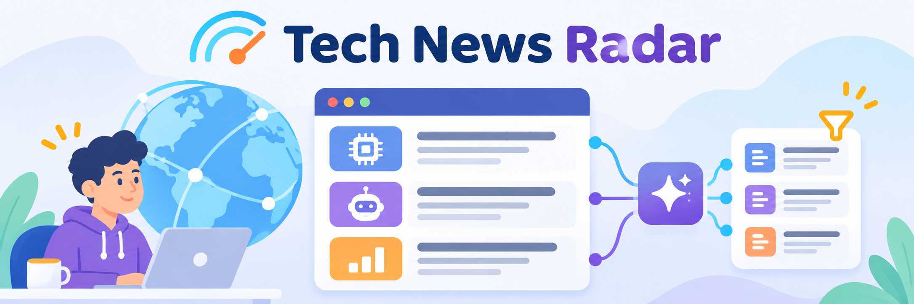

# Tech News Radar



[](README.md)
[](README.en.md)

A personal reader that brings technology, artificial intelligence, software
development, and economics news into one place.

Tech News Radar imports RSS/Atom feeds, lets readers search and filter articles,
manages sources and categories, and keeps per-user preferences and read states.
It includes a shared AI digest of the previous 24 hours, with links to the
sources. Gemini generation is active in the published instance; new
installations keep it disabled until explicitly configured.

The responsive interface is available in Italian and English. Local development
uses SQLite and requires no cloud account; multiuser authentication and public
deployment are separate configurations.

## Local quickstart

Requirements: Python 3.13, Node.js 24, and npm.

```sh
git clone https://github.com/giorgioinfo13/tech-news-radar.git
cd tech-news-radar
cp .env.example .env
python3 -m venv backend/.venv
backend/.venv/bin/python -m pip install --require-hashes -r backend/requirements-dev.txt
npm ci --prefix frontend
cd backend
.venv/bin/alembic upgrade head
cd ..
```

To access data without cloud services, enable these settings in your local
`.env`:

```dotenv
TNR_LOCAL_USER_ID=00000000-0000-0000-0000-000000000001
VITE_LOCAL_MODE=true
```

Then start the backend from the repository root:

```sh
cd backend
.venv/bin/python -m uvicorn app.main:create_app --factory --reload --host 127.0.0.1 --port 8000
```

Start the frontend in a second terminal:

```sh
npm run dev --prefix frontend
```

Open <http://127.0.0.1:5173>. The initial database contains no sources; add them
from the administration interface.

## Forks and deployment

The quickstart also works from a fork. Never commit the `.env` file. Collection
and release workflows are tied to the upstream repository; in a fork, adapt
their guards and configure your own variables, secrets, and services. See the
[deployment guide](docs/deployment.md) for a public installation.

Documentation: [development and tests](docs/development.md) ·
[architecture](docs/architecture.md) ·
[AI digest](docs/ai-briefs.md)

Distributed under the [MIT License](LICENSE). Third-party resources retain their
respective licenses.
